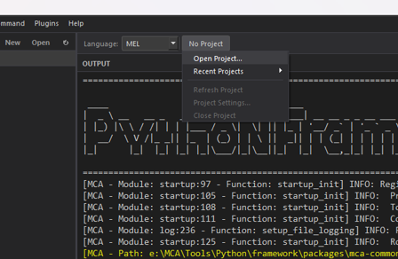
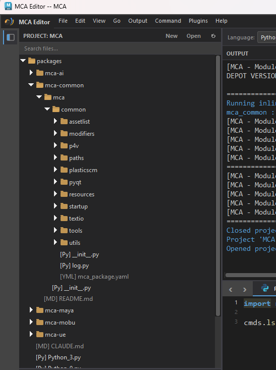
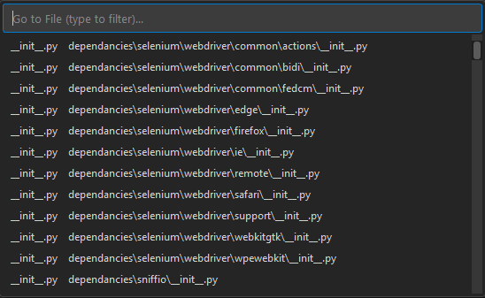
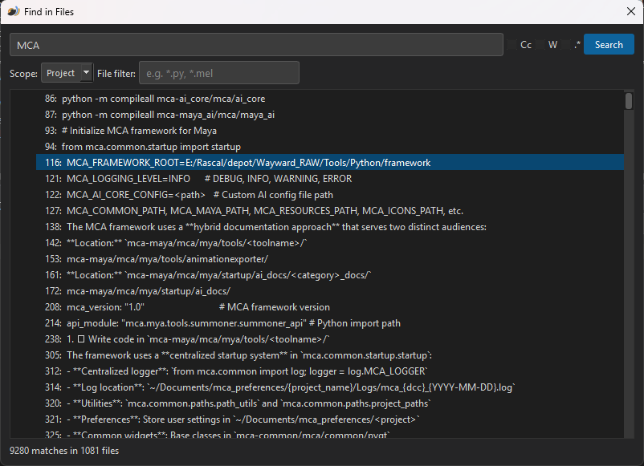

# Project Mode

Project Mode turns MCA Editor into a lightweight IDE. Open a folder, browse your file tree, and work across multiple files with project-wide search.

---

## Opening a Project

- **File > Open Project** or ++ctrl+shift+o++
- Select any folder on disk
- MCA Editor scans the folder and displays its contents in the sidebar

You can also create a new project from **File > New Project**, which generates a `.mca-project` configuration file.

---

## The Sidebar

When a project is open, the left sidebar shows your file tree:

- **Click** a file to open it in the editor
- **Double-click** to pin it (single-click opens in preview mode)
- Folders expand and collapse
- Files are filtered — common non-code files and folders are hidden by default

---

## Quick Open

Press ++ctrl+p++ to open the **Quick Open** dialog. Start typing a filename to fuzzy-search across your project. Press ++enter++ to open the selected file.

This is the fastest way to navigate large projects.

---

## Find in Files

Press ++ctrl+shift+f++ to search across all files in your project.

- Supports regex patterns
- Results grouped by file
- Click a result to jump directly to that line

---

## Project Configuration

Projects can have a `.mca-project` file in their root directory that configures:

- **Python paths** — Additional directories to add to the Python path when executing code
- **Excluded folders** — Directories to hide from the sidebar and search (e.g., `.git`, `__pycache__`, `node_modules`)

---

## Multi-Tab Editing

In Project Mode, each open file gets its own tab. You can:

- **Split the editor** — Drag a tab to the side to create a split view
- **Multiple editor groups** — Work on two files side by side
- **Modified indicator** — Tabs show a dot when they have unsaved changes

---

## When to Use Project Mode

Project Mode is ideal for:

- Maya tool development
- Pipeline scripts with multiple files
- Any work that spans more than a couple of files
- When you need project-wide search
